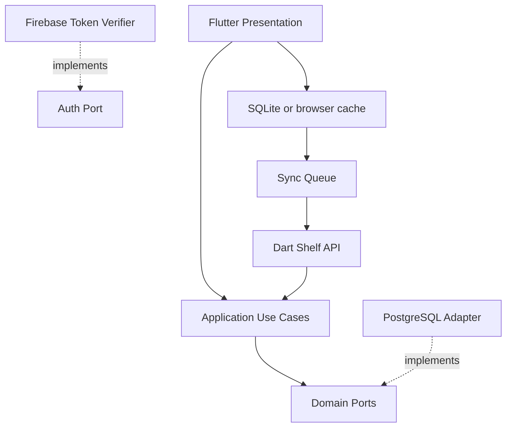
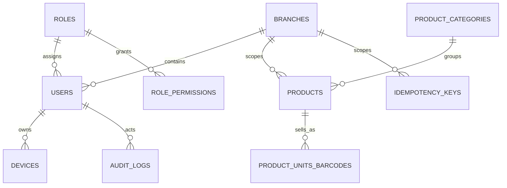
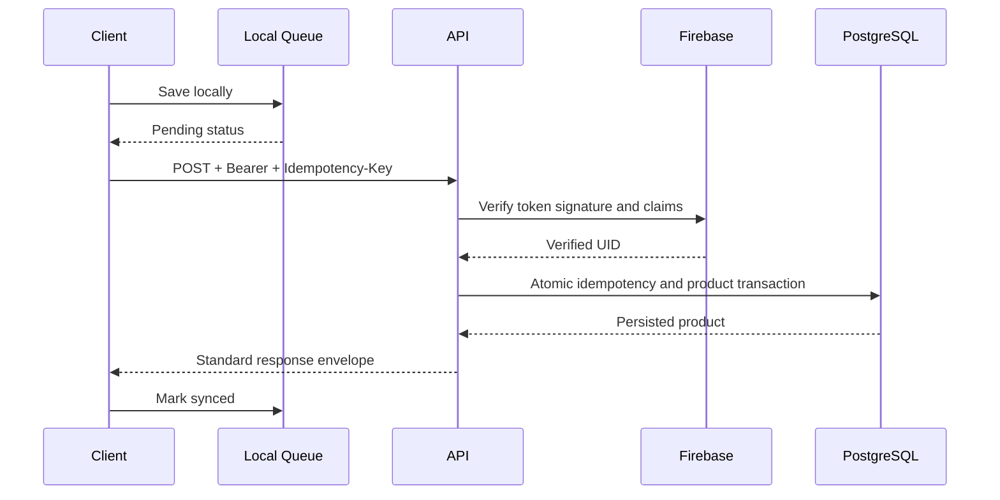

# Iteration 01 — Architecture

## Layered design

## PostgreSQL ERD

## Request sequence

## Hosting
Flutter Web on Firebase Hosting; Dart API on an HTTPS container host; PostgreSQL on Supabase or Neon. Secrets belong in host secret managers. Production CORS must use explicit origins. Android and Windows share the same API.

## Boundaries
Presentation calls use cases only. Application depends on domain ports. Infrastructure implements ports. Firebase token verification is fail-closed. Idempotency reservation and product writes share a transaction. Browser builds must not invoke sqflite or dart:io.

## Scope limits
This iteration establishes authentication/catalog foundation, not POS, purchasing, stock valuation or full accounting.

## Acceptance
- [ ] Dart analyze and tests
- [ ] Flutter analyze, widget tests, APK and Web builds
- [ ] PostgreSQL migration on clean database
- [ ] Firebase emulator verification
- [ ] Two-client retry/idempotency test
